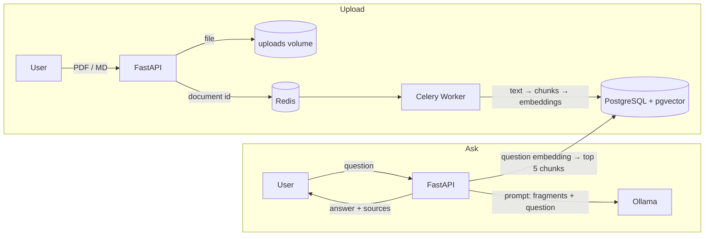

# RAG Platform

A backend service that answers questions **from your own documents** and shows **citations**:
which file and page each part of the answer comes from.
If the answer is not in the documents, it says so instead of making something up.

Upload PDF or Markdown files to a collection, wait until they are processed in the background,
and ask questions in Russian or English.

Runs fully locally: embeddings and the LLM work on your machine, documents never leave the server.

## Example

```bash
curl -X POST localhost:8000/collections/{collection_id}/ask \
  -H "Content-Type: application/json" \
  -d '{"question": "Сколько дней отпуска?"}'
```

```json
{
  "answer": "Сотрудникам положено 28 календарных дней отпуска [1].",
  "sources": [
    {
      "number": 1,
      "document_id": "b47d2288-...",
      "filename": "vacation.md",
      "page": null,
      "content": "# Отпуск Каждый сотрудник имеет право на ежегодный оплачиваемый отпуск 28 календарных дней."
    }
  ]
}
```

A question that the documents cannot answer:

```json
{"answer": "В документах нет ответа на этот вопрос", "sources": []}
```

## Features

- Collections of documents, PDF and Markdown upload
- Background processing with Celery: upload returns `202` right away, status goes `processing` → `ready` / `failed` with an error message
- Text extraction page by page, so citations include the page number
- Chunking with overlap, multilingual embeddings (384 dimensions) stored in PostgreSQL with pgvector
- Semantic search: finds "Wi-Fi" for the question "вайфай"
- Answers only from the found fragments, citations are taken from the database, not from the model text
- No LLM call when nothing is found; "no answer" response instead of hallucinations
- Upload safety: files are saved under a generated id (no path traversal), format is checked by content (`%PDF-` signature, UTF-8), size limit is checked while streaming (`413`)
- Collections are isolated: search never returns chunks from another collection
- Runs with one command using Docker Compose

## Tech stack

- Python, FastAPI, Pydantic
- PostgreSQL + pgvector, SQLAlchemy (async), Alembic
- Celery, Redis
- fastembed (`paraphrase-multilingual-MiniLM-L12-v2`), pypdf
- Ollama (`qwen2.5:3b`) as a local LLM, httpx
- pytest
- Docker, Docker Compose

## How it works



**Upload**

1. The API checks the file, saves it under the document id and creates a document with status `processing`.
2. After the commit, the API puts the document id into the Redis queue and returns `202`.
3. The worker extracts text page by page, splits it into chunks with overlap, computes embeddings and saves the chunks.
4. The document gets status `ready`, or `failed` with an error (for example, a scanned PDF without text).

**Ask**

1. The question is turned into a vector with the same embedding model.
2. pgvector finds the 5 closest chunks inside the collection.
3. The LLM gets numbered fragments and strict rules: answer only from the fragments, cite them like `[1]`, or reply "no answer".
4. Citation numbers are parsed from the answer and mapped back to documents and pages from the database.

## API

| Method | Path | Description | Response |
|--------|------|-------------|----------|
| `POST` | `/collections` | Create a collection | `201` |
| `GET` | `/collections` | List collections | `200` |
| `POST` | `/collections/{id}/documents` | Upload a PDF or Markdown file | `202`, `400`, `404`, `413` |
| `GET` | `/collections/{id}/documents` | List documents with their status | `200`, `404` |
| `POST` | `/collections/{id}/ask` | Ask a question, get an answer with citations | `200`, `404`, `422`, `503` |

Interactive docs: http://localhost:8000/docs

## Getting started

1. Install [Ollama](https://ollama.com/download) and download the model:

   ```bash
   ollama pull qwen2.5:3b
   ```

2. Clone the repository, go to the project folder and create a `.env` file:

   ```bash
   cp .env.example .env
   ```

3. Start everything:

   ```bash
   docker compose up --build -d
   ```

   This starts four containers: `db`, `redis`, `api` and `worker`.
   Migrations are applied automatically when the API starts.
   The embedding model (~240 MB) is downloaded on first use and cached in a Docker volume.

4. Open http://localhost:8000/docs, create a collection, upload a document and ask a question.

Useful commands:

```bash
docker compose logs worker -f   # follow the worker logs
docker compose stop             # stop everything (data is kept)
```

## Running tests

```bash
python -m venv venv
source venv/bin/activate
pip install -r requirements.txt
pytest -v
```

## Project structure

```text
rag-platform/
├── app/
│   ├── api/            # routers and dependencies
│   ├── core/           # settings
│   ├── db/             # database session
│   ├── models/         # SQLAlchemy models: collections, documents, chunks
│   ├── repositories/   # database queries, vector search
│   ├── schemas/        # Pydantic schemas
│   ├── services/       # storage, extractor, chunker, embedder, LLM client, ask
│   └── worker/         # Celery app and document processing task
├── alembic/            # database migrations
├── docs/design.md      # design doc
├── tests/              # pytest tests
├── docker-compose.yml
├── Dockerfile
└── requirements.txt
```

## Roadmap

- Evaluation set and metrics: retrieval hit rate, faithfulness, latency
- Distance threshold for search results, HNSW index for large collections
- JWT auth and a web chat frontend
- Claude API as an alternative LLM (only `app/services/llm.py` needs to change)
- More formats: Word, HTML, web pages
