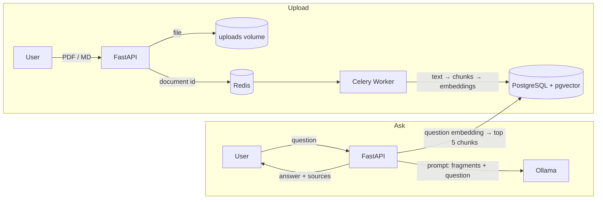

# RAG Platform

A backend service that answers questions **from your own documents** and shows **citations**:
which file and page each part of the answer comes from.
If the answer is not in the documents, it says so instead of making something up.

Upload PDF or Markdown files to a collection, wait until they are processed in the background,
and ask questions in Russian or English.

Runs fully locally: embeddings and the LLM work on your machine, documents never leave the server.

## Example

```bash
curl -X POST localhost:8000/collections/{collection_id}/ask \
  -H "Authorization: Bearer $TOKEN" \
  -H "Content-Type: application/json" \
  -d '{"question": "Сколько дней отпуска?"}'
```

```json
{
  "answer": "Сотрудникам положено 28 календарных дней отпуска [1].",
  "sources": [
    {
      "number": 1,
      "document_id": "b47d2288-...",
      "filename": "vacation.md",
      "page": null,
      "content": "# Отпуск Каждый сотрудник имеет право на ежегодный оплачиваемый отпуск 28 календарных дней."
    }
  ]
}
```

A question that the documents cannot answer:

```json
{"answer": "В документах нет ответа на этот вопрос", "sources": []}
```

## Features

- Collections of documents, PDF and Markdown upload
- Background processing with Celery: upload returns `202` right away, status goes `processing` → `ready` / `failed` with an error message
- Text extraction page by page, so citations include the page number
- Chunking with overlap, multilingual embeddings (384 dimensions) stored in PostgreSQL with pgvector
- Semantic search: finds "Wi-Fi" for the question "вайфай"
- Answers only from the found fragments, citations are taken from the database, not from the model text
- No LLM call when nothing is found; "no answer" response instead of hallucinations
- Upload safety: files are saved under a generated id (no path traversal), format is checked by content (`%PDF-` signature, UTF-8), size limit is checked while streaming (`413`)
- Collections are isolated: search never returns chunks from another collection
- Runs with one command using Docker Compose

## Tech stack

- Python, FastAPI, Pydantic
- PostgreSQL + pgvector, SQLAlchemy (async), Alembic
- Celery, Redis
- fastembed (`paraphrase-multilingual-MiniLM-L12-v2`), pypdf
- Ollama (`qwen2.5:3b`) as a local LLM, httpx
- pytest
- Docker, Docker Compose

The web chat was built with AI assistance.

## How it works



**Upload**

1. The API checks the file, saves it under the document id and creates a document with status `processing`.
2. After the commit, the API puts the document id into the Redis queue and returns `202`.
3. The worker extracts text page by page, splits it into chunks with overlap, computes embeddings and saves the chunks.
4. The document gets status `ready`, or `failed` with an error (for example, a scanned PDF without text).

**Ask**

1. The question is turned into a vector with the same embedding model.
2. pgvector finds the 5 closest chunks inside the collection.
3. The LLM gets numbered fragments and strict rules: answer only from the fragments, cite them like `[1]`, or reply "no answer".
4. Citation numbers are parsed from the answer and mapped back to documents and pages from the database.

## API

| Method | Path | Description | Response |
|--------|------|-------------|----------|
| `POST` | `/auth/register` | Register with a JSON username and password | `201`, `409`, `422` |
| `POST` | `/auth/login` | Exchange form credentials for a JWT | `200`, `401` |
| `GET` | `/auth/me` | Get the authenticated user | `200`, `401` |
| `POST` | `/collections` | Create a collection | `201` |
| `GET` | `/collections` | List collections | `200` |
| `POST` | `/collections/{id}/documents` | Upload a PDF or Markdown file | `202`, `400`, `404`, `413` |
| `GET` | `/collections/{id}/documents` | List documents with their status | `200`, `404` |
| `POST` | `/collections/{id}/ask` | Ask a question, get an answer with citations | `200`, `404`, `422`, `503` |
| `GET` | `/collections/{id}/history` | Read saved questions, answers and citations, newest first | `200`, `404` |

History accepts `limit` (1–100, default 20) and `offset` (default 0). Successful
`/ask` responses, including answers with no supporting sources, are saved. Requests
that fail before an answer is returned are excluded.

All collection endpoints require `Authorization: Bearer <token>`. Invalid or missing
credentials return `401`. A collection belonging to another account returns `404`.
Collections created before authentication retain their files and data with no owner
and are hidden from the API until an administrator assigns an owner in the database.

Ask and upload are limited per user. Sign-in and registration are limited per
client IP. The defaults are 5, 3, 10, and 5 requests per 60 seconds, respectively.
A limited request returns `429` with `Retry-After` in seconds.

Interactive docs: http://localhost:8000/docs

## Getting started

1. Install [Ollama](https://ollama.com/download) and download the model:

   ```bash
   ollama pull qwen2.5:3b
   ```

2. Clone the repository, go to the project folder and create a `.env` file:

   ```bash
   cp .env.example .env
   python -c 'import secrets; print(secrets.token_urlsafe(48))'
   ```

   Set `JWT_SECRET_KEY` in `.env` to the generated value.

3. Start everything:

   ```bash
   docker compose up --build -d
   ```

   This starts five containers: `frontend`, `api`, `worker`, `db` and `redis`.
   Caddy serves the web chat and forwards API requests to FastAPI on the Docker network.
   Migrations are applied automatically when the API starts.
   The embedding model (~240 MB) is downloaded on first use and cached in a Docker volume.

4. Open http://localhost:8000, register and sign in. Create a collection, upload a
   document, wait until it is ready and ask a question. The chat displays saved
   answers and lets you expand their source excerpts. Swagger remains available at
   http://localhost:8000/docs.

Useful commands:

```bash
docker compose logs worker -f   # follow the worker logs
docker compose stop             # stop everything (data is kept)
```

## Testing with your own document

After registering through the web chat, create a test collection from an existing
Markdown file with `python scripts/seed_demo.py USERNAME path/to/document.md`.
Run `python scripts/load_ask.py COLLECTION_ID --question "Your question"` to check
the request limit on that collection.

## Running tests

```bash
python -m venv venv
source venv/bin/activate
pip install -r backend/requirements.txt
cd backend
pytest -v
```

## Project structure

```text
rag-platform/
├── backend/
│   ├── app/            # API, services, repositories, models and Celery worker
│   ├── alembic/        # database migrations
│   ├── evals/          # RAG quality checks
│   ├── tests/          # pytest tests
│   ├── Dockerfile
│   └── requirements.txt
├── frontend/
│   ├── public/         # HTML, CSS, UI code and API client
│   └── Caddyfile       # static server and reverse proxy
├── docs/
├── scripts/            # demo setup and load check
└── docker-compose.yml
```

## Quality evaluation

With Ollama running and the configured model installed, run
`python -m evals.run_evals` from `backend/`. The runner compares retrieval
hit rates across chunk sizes and evaluates answers with the backend's default
chunking and retrieval limit.

Answer scores use normalized reference phrases and optional variants from
`backend/evals/questions.json`. A citation passes when every numeric reference is in range
and at least one cited fragment contains the reference evidence. These string checks
can miss paraphrases and do not establish whether every claim is supported.

## Roadmap

- Evaluation set and metrics: retrieval hit rate, faithfulness, latency
- Distance threshold for search results, HNSW index for large collections
- Host the public demo
- Claude API as an alternative LLM (only `backend/app/services/llm.py` needs to change)
- More formats: Word, HTML, web pages
