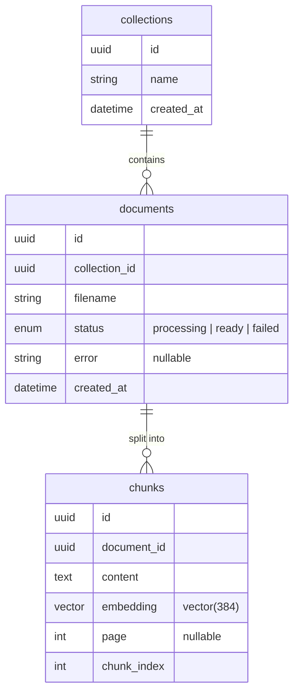
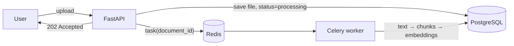

# RAG Platform — Design Doc

**Status:** draft · **Author:** Alexandr Tkachenko

## 1. Goal

Large language models do not know private documents (company rules, internal docs)
and may confidently invent an answer (hallucination).
Sending all documents with every question is impossible: the context window is limited,
every token costs money, and only a few pages are relevant.

This platform answers questions **from uploaded documents only** and shows **citations**:
which document and page each part of the answer comes from.

Approach: **RAG** (Retrieval-Augmented Generation) —
find relevant pieces of text → add them to the prompt → generate an answer.

## 2. User scenario

1. The user creates a collection (for example, "FastAPI documentation").
2. The user uploads documents (PDF, Markdown).
3. The user sees the status of each document: `processing` → `ready` / `failed`.
4. The user asks a question inside the collection.
5. The user gets an answer with citations: document, page, text fragment.
6. If the answer is not in the documents, the system says so instead of guessing.

## 3. Scope and roadmap

| Stage | What | Why now |
|-------|------|---------|
| **1. MVP** | Collections, PDF/Markdown upload, background processing with status, question → answer with citations | The full scenario works end to end |
| **2. Quality** | Evaluation set and metrics (evals) | Measure before tuning chunk size, top-k and prompts |
| **3. Product** | JWT auth, web frontend (chat), question history | Required before a public deploy |
| **4. Release** | Deploy with a public link and rate limits; more formats (Word, HTML, web pages) | New formats are just new loaders on top of a working system |

## 4. API (MVP)

| Method | Path | Description | Response |
|--------|------|-------------|----------|
| `POST` | `/collections` | Create a collection | `201` |
| `GET` | `/collections` | List collections | `200` |
| `POST` | `/collections/{id}/documents` | Upload a file and queue it for processing | `202` + document with `status: processing` |
| `GET` | `/collections/{id}/documents` | List documents with their status | `200` |
| `POST` | `/collections/{id}/ask` | Ask a question, get an answer with citations | `200` |

- Upload returns `202 Accepted`, not `201`: processing happens later in the background.
- `/ask` is `POST`: the question goes in the JSON body (no URL length limits),
  and every call costs money, so it must not be cached like a `GET`.

## 5. Data model

- **Files are not stored in the database.** They are saved on disk (a Docker volume, later object storage).
- **A chunk stores both the vector and the text.** The vector is used for search;
  the text is sent to the model and shown in citations. Text cannot be restored from a vector.
- `page` is empty for Markdown. `chunk_index` keeps the order of chunks inside a document.

## 6. Pipelines

### 6.1 Document ingestion (asynchronous)

**API** (milliseconds):
1. Save the file to disk.
2. Create a `documents` row with `status = processing`.
3. Queue a task with **only the `document_id`** (Redis keeps tasks in memory — pass ids, not files).
4. Return `202` immediately.

**Worker** (seconds to minutes):
5. Load the document and the file.
6. Extract text with page numbers.
7. Split into chunks with overlap.
8. Compute an embedding for each chunk (local open-source model).
9. Save chunks to PostgreSQL (pgvector).
10. Set `status = ready`. On any error: `status = failed` and a readable `error`.

The user checks progress with `GET /collections/{id}/documents`.

### 6.2 Question answering (synchronous, a few seconds)

1. Turn the question into an embedding — **with the same model** as the chunks.
2. Find the top-k (for example, 5) nearest chunks in pgvector, **only inside this collection**. ← Retrieval
3. Build the prompt: instructions + numbered fragments + question. ← Augmented
4. Call the Claude API. The model must answer only from the fragments,
   say when the answer is missing, and reference fragment numbers. ← Generation
5. Build citations **from our database** (document, page, text) using the fragment numbers.
6. Return `{ answer, citations }`.

### 6.3 Key parameters

| Parameter | Trade-off | Starting value |
|-----------|-----------|----------------|
| Chunk size | Too small loses context ("It is granted after…"); too large blurs the vector and wastes tokens | ~500 tokens |
| Overlap | Keeps sentences connected across chunk borders | ~50–100 tokens |
| top-k | Too few may miss the answer; too many add noise and cost | 5 |

These values are tuned in stage 2 using metrics, not by guessing.

## 7. Tech stack

- **API:** FastAPI, Pydantic
- **Background jobs:** Celery + Redis
- **Database:** PostgreSQL + pgvector, SQLAlchemy (async), Alembic
- **Embeddings:** local open-source model (free, 384-dimensional vectors)
- **LLM:** Claude API (`anthropic` Python SDK)
- **Tests:** pytest
- **Run:** Docker Compose

## 8. Risks

| Area | Risk | Mitigation |
|------|------|------------|
| Upload | Broken file | Worker catches the error → `failed` + message |
| Upload | Huge file | Size limit (for example, 20 MB) → `413` |
| Upload | Wrong format | Accept only PDF and Markdown → `400` |
| Upload | Scanned PDF with no text | Empty text → `failed: "no text found"`; OCR later |
| Search | Wrong chunks found | Measure retrieval quality and tune chunk size / top-k |
| Model | Hallucinations | Strict instructions, citations from our database, faithfulness checks |
| Cost | Abuse of the public API | Rate limiting (Redis), question length limit, auth before deploy |

## 9. Metrics

1. **Retrieval hit rate** — share of test questions where the chunk with the answer is in the top-k.
   Checks search without the model.
2. **Faithfulness** — the answer is based only on the retrieved fragments.
3. **Latency** — seconds from question to answer.
4. **Cost per question** — tokens and money per `/ask` call.
